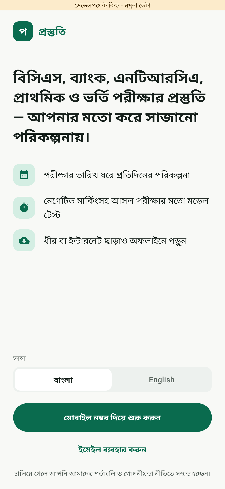
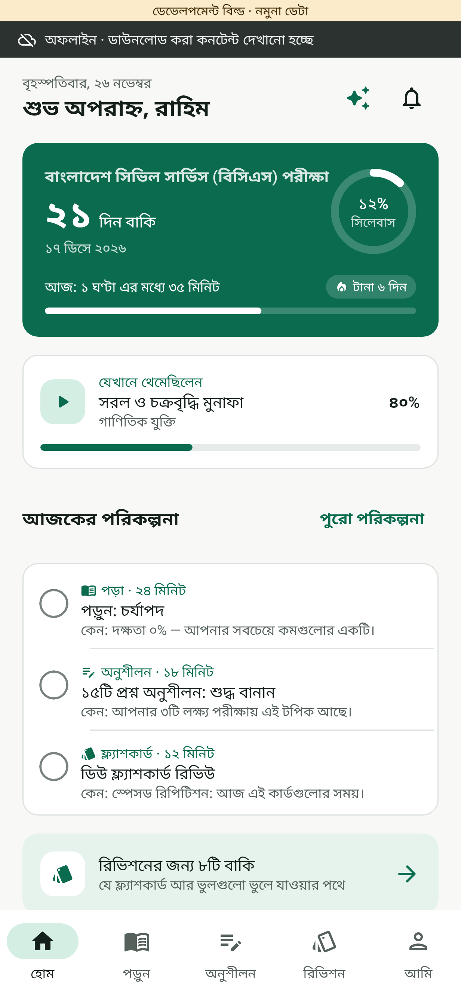
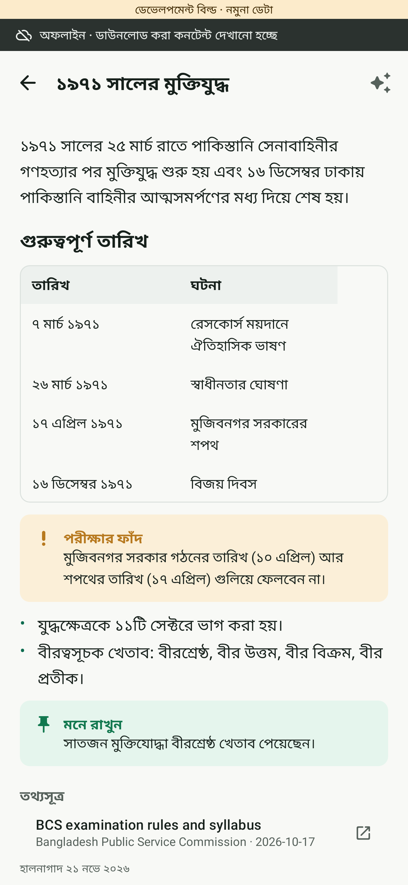
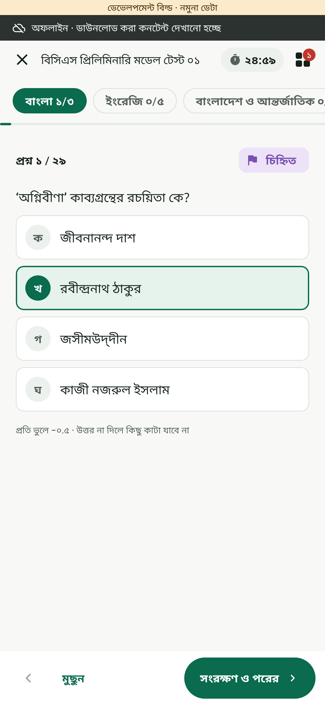
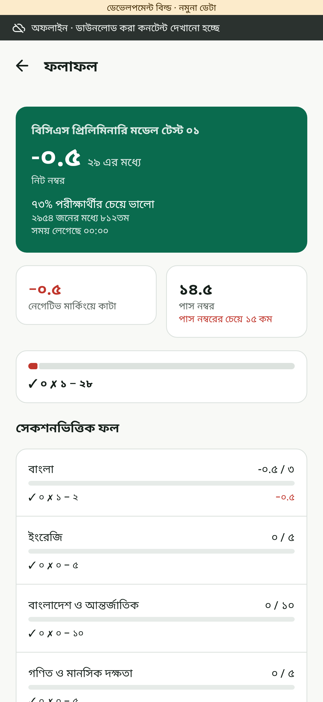

# Prostuti · প্রস্তুতি

An Android app for Bangladesh competitive-exam preparation: BCS, government jobs, bank recruitment,
NTRCA teacher registration, primary teacher recruitment and university admission.

Students get a personalised daily plan, a syllabus they can study online or offline, a bilingual
question bank, practice modes with instant explanations, realistic server-timed model tests with
negative marking, an AI tutor grounded in approved content, spaced-repetition revision and analytics
that explain what to do next.

| Welcome | Home | Study notes | Model test | Result |
|---|---|---|---|---|
|  |  |  |  |  |

The screenshots are produced by the end-to-end test (see [Testing](#testing)).

---

## Tech stack

Kotlin 2.1 · Jetpack Compose + Material 3 · MVVM + Clean Architecture · Hilt · Retrofit/OkHttp ·
kotlinx.serialization · Coroutines/Flow · Room · DataStore · WorkManager · Navigation Compose
(type-safe routes) · Coil. Min SDK 24, target SDK 35.

## Project structure

```
app/                     Application, MainActivity, root navigation, flavor-specific DI
  src/live/              Repository bindings to the real backend (shipped to users)
  src/mock/              Repository bindings to the development mock backend
build-logic/convention/  Gradle convention plugins (library, feature, compose, hilt, room…)
core/
  model/                 Pure-Kotlin domain models
  common/                AppResult/AppError, dispatcher qualifiers, TimeSource
  domain/                Repository contracts, use cases and exam-critical logic (pure Kotlin)
  network/               Typed Retrofit API, DTOs, auth/refresh/retry interceptors, error mapping
  database/              Room database, DAOs, migrations, exported schemas
  datastore/             Keystore-encrypted token store, preferences
  data/                  Live repositories, offline outbox, sync/download/reminder workers
  mockbackend/           DEVELOPMENT ONLY: in-memory sample backend (mock flavor)
  designsystem/          Theme, colours, typography, reusable components
  ui/                    Shared domain-aware UI (question renderer, content blocks, states)
feature/                 auth, onboarding, dashboard, exams, learn, questionbank, practice,
                         mockexam, analytics, assistant, planner, revision, offline,
                         community, profile
```

Features never depend on each other. They ask for a `Destination` (`core/ui/Navigation.kt`) and
the app's `DestinationNavigator` maps it to a concrete route. See [docs/ARCHITECTURE.md](docs/ARCHITECTURE.md).

## Build variants

| Flavor | Backend | Purpose |
|---|---|---|
| `live` | NestJS API at `prostuti.apiBaseUrl` | The only flavor distributed to students |
| `mock` | `:core:mockbackend` (in-memory sample data) | Development, demos, UI tests. **No release build** |

The mock flavor shows a "Development build · sample data" banner. Its OTP is `123456`.
Payments are disabled in it.

## Getting started

Requirements: JDK 17+, Android SDK 35.

```bash
./gradlew :app:installMockDebug
```

```bash
./gradlew :app:installLiveDebug -Pprostuti.apiBaseUrl=https://staging-api.example.com/
```

### Environment configuration

| Gradle property | Default | Used for |
|---|---|---|
| `prostuti.apiBaseUrl` | `https://api.prostuti.app/` | Live backend base URL (must end with `/`) |
| `robolectric.repoUrl` | Maven Central | Optional mirror for Robolectric runtime jars |

Put them in `~/.gradle/gradle.properties` or pass with `-P`. No secrets are stored in the app:
AI-provider keys, payment credentials and OTP gateways live on the backend only.

### Release builds

1. Copy `keystore.properties.example` to `keystore.properties` and fill it in (git-ignored).
2. Run this:

```bash
./gradlew :app:bundleLiveRelease
```

Release builds use R8 with resource shrinking and only keep `en` and `bn` resources; the live
release APK is about 3 MB. Without `keystore.properties` the release build falls back to the debug
key, which is fine for local testing but not for distribution.

## Testing

```bash
./gradlew testDebugUnitTest :core:domain:test :core:common:test :app:testMockDebugUnitTest
```

| Area | Tests |
|---|---|
| Negative marking, guessing break-even | `core/domain/.../NegativeMarkingTest` |
| Server-anchored exam timer (device clock changes have no effect) | `ServerAnchoredClockTest` |
| Question navigation, answer selection, review marks, locked sections | `ExamSessionStateTest` |
| Deterministic shuffling of questions/options | `OptionShufflerTest` |
| SM-2 spaced repetition | `SpacedRepetitionTest` |
| Offline practice scoring and next-step recommendation | `PracticeEvaluatorTest` |
| Token expiry → refresh → retry, rejected refresh, retry on dropped connections, validation errors | `core/network/.../TokenRefreshTest` |
| Room v1→v2 migration | `core/database/.../MigrationTest` |
| Offline outbox sync, rejection handling, offline practice fallback | `core/data/.../OfflineSyncTest` |
| Mock exam: start/resume, autosave, auto-submit on server timeout, retrying submission | `feature/mockexam/.../MockExamViewModelTest` |
| Exam UI: selecting, navigating, marking, submit confirmation, negative-marking display | `MockExamContentTest` (Compose + Robolectric) |
| Full flow: OTP sign-in → onboarding → home → learn → practice → model test → result | `app/src/testMock/.../EndToEndFlowTest` |

The end-to-end test writes screenshots of every step to `app/build/screenshots/`.
All UI tests run on the JVM with Robolectric, so no emulator is needed.

## Backend contract

The app expects the NestJS endpoints documented in [docs/api-contract.md](docs/api-contract.md).
The typed client lives in `core/network/.../api/ProstutiApi.kt`. When the backend publishes its
OpenAPI document, regenerate or diff the DTOs in `core/network/.../dto` against it.
